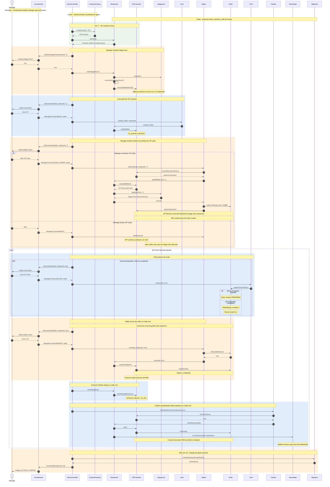

# Stage 3 Sequence Diagram — VIP Customer During Happy Hour

This sequence diagram illustrates how a manager's decisions influence a VIP customer's satisfaction and final bill during Happy Hour. It follows the Stage 3 restaurant simulation from customer arrival to payment and final game evaluation.

## Design Explanation

**Boundary:** `ConsoleView` receives manager commands and displays the game state.

**Control:** `GameController` coordinates customer arrivals, staff actions, turn progression and game evaluation.

**Entity:** `Restaurant`, `VIPCustomer`, `HappyHour`, `Host`, `Waiter`, `Chef`, `Cashier`, `Order`, `GameStats` and `Objective` manage the restaurant's business logic.

**Manager decision:** Taking the VIP order while Happy Hour is active locks in both discounts. Delaying the order may result in lower satisfaction and loss of the Happy Hour discount.

**Turn constraints:** The Chef can prepare an order after it is taken, but the Waiter cannot serve it until a later turn. The customer must finish eating before becoming eligible for payment on a subsequent turn.
